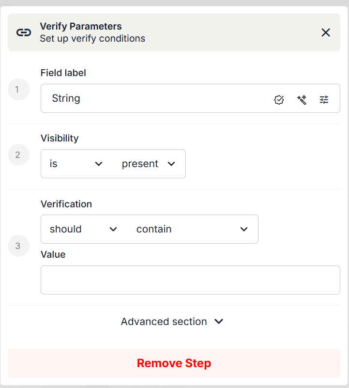

# Verification

## Verify Field

The **Verify Field** command checks one or more properties of a field and validates its value or state. It's typically used to confirm a field is visible, enabled, contains expected text, or matches specific conditions.

### Field setup

Start by selecting the **field** you want to verify. You can then configure a series of checks, starting with visibility and then content or value validation.

### Visibility conditions

The first check determines the **visibility or state** of the field. You can verify whether the field **is** or **is not**:

| Condition | Meaning |
| --- | --- |
| **present** | The field exists in the DOM |
| **visible** | The field is currently shown on the page |
| **enabled** | The field is active and can be interacted with |
| **checked** | Applicable to checkboxes and toggles |
| **editable** | The field allows text entry |
| **selected** | Applies to dropdowns and options |

This confirms the field's presence and availability before continuing with further validations.

### Verification conditions

After the visibility check you can add a value or content verification. Use the **Verification** dropdown to select:

- **should**: the field is expected to match the condition
- **should not**: the field is expected *not* to match the condition
- **none**: skip content verification and use only the visibility check

Then choose what to verify:

| Condition | Passes when |
| --- | --- |
| **empty** | The field has no value |
| **contain** | The field includes a specific substring |
| **equal** | The field exactly matches the expected value |
| **start with** | The value starts with the given text |
| **end with** | The value ends with the given text |
| **be less than** | The numeric value is smaller than expected |
| **be less than or equal** | The numeric value is smaller or equal |
| **be greater than** | The numeric value is larger than expected |
| **be greater than or equal** | The numeric value is larger or equal |
| **match regex** | The value matches a regular expression |

### Expected value

Finally, enter the **value** you expect the field to meet for the selected condition. This can be a fixed string or a variable.

**Example**

| Step | Setting |
| --- | --- |
| Verification | `should` |
| Condition | `contain` |
| Value | `Pending` |

The test passes only if the field's text contains the word *Pending*.

!!! tip "Branching instead of failing"
    Right-click a verify step and choose **Add conditional** to run one set of steps when the check passes and another when it does not. See [Conditionals](../tests/conditionals.md).

---

## Verify Variable

The **Verify Variable** command works like [Verify Field](#verify-field), except it checks a saved variable rather than something on the page. Nothing needs to be visible for it to run.

Use it to check a value you captured earlier, for example a total pulled out of a spreadsheet with [Set Variable](variables.md#set-variable), a reference built with [Modify Variable](variables.md#modify-variable), or an answer returned by [Ask AI](ai.md#ask-ai).

### Parameters

- **Variable**: the variable you want to check, picked from the variables available to the test
- **Verification**: `should` or `should not`, followed by the condition
- **Value**: what you expect. This can be a fixed string or another variable

There is no visibility check. A variable either holds a value or it does not, so the command goes straight to the comparison.

### Conditions

The same set as Verify Field: **empty**, **contain**, **equal**, **start with**, **end with**, the four numeric comparisons, and **match regex**. See [Verification conditions](#verification-conditions) for what each one passes on.

**Example**

| Step | Setting |
| --- | --- |
| Variable | `Extract Value - Excel` |
| Verification | `should` |
| Condition | `equal` |
| Value | `1250.00` |

The test passes only if the value saved in that variable is exactly `1250.00`.

### Advanced

| Option | Effect |
| --- | --- |
| **Timeout (s)** | How long to wait before the check fails. Defaults to 15 seconds |
| **Error message** | Optional. A custom error shown when the check fails |
| **Continue on failure** | Records the failure and lets the test carry on |

!!! tip "Continue on failure"
    Useful when you want every check in a run reported, rather than the test stopping at the first one that breaks. Leave it off when later steps only make sense if this check passed.

!!! tip "Comparing two variables"
    Put a variable in the **Value** field to check one variable against another, such as a total read from the screen against a total read from a downloaded file.

---

## Verify using AI

Checks that cannot be expressed as a field condition are better handled by [Verify using AI](ai.md#verify-using-ai). It screenshots the field or the page and judges it against a plain-English expectation, such as *"Validate that the GST is included"*. Use it for on-screen reports and invoices, icon-based fields, and anything where you would otherwise need a dozen separate Verify Field steps.
